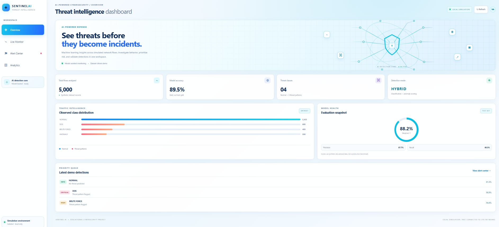
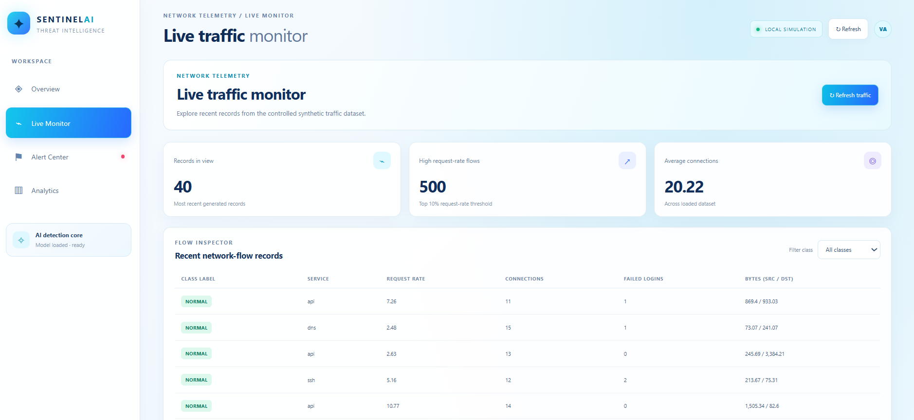
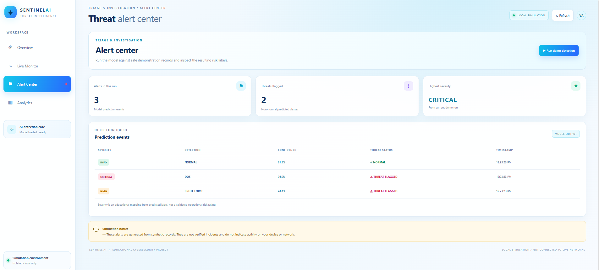
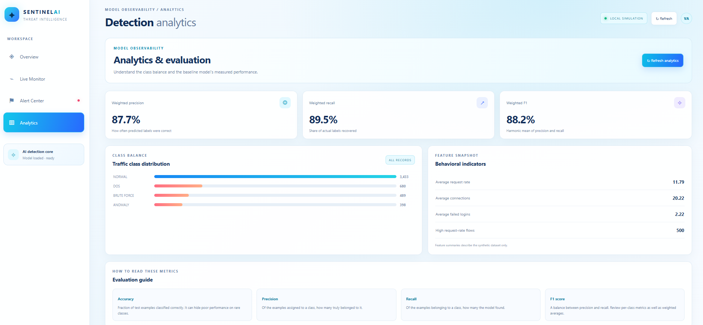
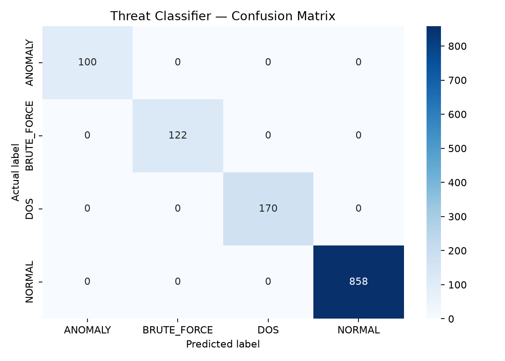

# AI-Powered Cybersecurity Threat Detection System

An ML-based cybersecurity application that analyzes synthetic network traffic, classifies potential threats, detects anomalous activity, and presents security insights through an interactive dashboard.

## Overview

This project demonstrates machine learning for network threat monitoring in a simulated environment. It uses 5,000 synthetic network traffic records to classify activity into four categories: `NORMAL`, `DOS`, `BRUTE_FORCE`, and `ANOMALY`.

## Key Features

- **Threat Classification:** Classifies network traffic using supervised machine learning.
- **Anomaly Detection:** Uses Isolation Forest to identify unusual traffic patterns.
- **Risk Categorization:** Assigns severity levels to detected threat categories.
- **Interactive Dashboard:** Includes Overview, Live Monitor, Alert Center, and Analytics sections.
- **Model Evaluation:** Displays accuracy, precision, recall, F1-score, and a confusion matrix.
- **Flask API:** Provides endpoints for traffic summaries, alerts, analytics, health checks, and predictions.
- **Synthetic Dataset:** Supports safe testing without accessing real corporate networks.

## Tech Stack

- Python
- Scikit-learn
- Pandas and NumPy
- Matplotlib
- Flask
- HTML, CSS, and JavaScript
- Pytest

## Project Structure

    AI-Cybersecurity-Threat-Detection/
    ├── data/
    │   └── synthetic_network_traffic.csv
    ├── docs/
    │   ├── architecture.md
    │   ├── limitations.md
    │   └── testing.md
    ├── images/
    │   ├── 01-dashboard-overview.png
    │   ├── 02-live-traffic-monitor.png
    │   ├── 03-threat-alert-center.png
    │   ├── 04-model-analytics.png
    │   └── 05-confusion-matrix.png
    ├── models/
    ├── outputs/
    ├── src/
    ├── tests/
    ├── web/
    ├── app.py
    ├── requirements.txt
    └── README.md

## Model Performance

| Metric | Score |
|---|---:|
| Accuracy | 89.52% |
| Weighted Precision | 87.74% |
| Weighted Recall | 89.52% |
| Weighted F1-Score | 88.15% |

These results are based on synthetic data. Performance varies across threat categories, and anomaly detection requires further improvement. These scores do not establish real-world effectiveness.

## Getting Started

### 1. Clone the Repository

    git clone <your-github-repository-url>
    cd AI-Cybersecurity-Threat-Detection

### 2. Create and Activate a Virtual Environment

**Windows PowerShell:**

    python -m venv .venv
    .\.venv\Scripts\Activate.ps1

### 3. Install Dependencies

    pip install -r requirements.txt

### 4. Train the Model

    python -m src.train

### 5. Run Sample Predictions

    python -m src.detect

### 6. Start the Dashboard

    python app.py

Open the local URL displayed in the terminal to access the dashboard.

### 7. Run Tests

    python -m pytest -q

## Dashboard Screenshots

### Overview

### Live Traffic Monitor

### Threat Alert Center

### Model Analytics

### Confusion Matrix

## Limitations

- Uses synthetic rather than live network traffic.
- Model performance may not generalize to real-world attacks.
- Further evaluation and improvement are needed before practical deployment.

## Future Scope

- Evaluate models on suitable public intrusion detection datasets.
- Improve detection of underrepresented threat patterns.
- Add streaming traffic ingestion and alert correlation.
- Explore explainable AI to make predictions easier to interpret.

## Disclaimer

This project is intended for educational, research, and defensive cybersecurity demonstration purposes. It is not a production-ready security monitoring system.

## Author

Developed as a student portfolio project exploring machine learning, network threat detection, anomaly detection, and cybersecurity dashboard development.
